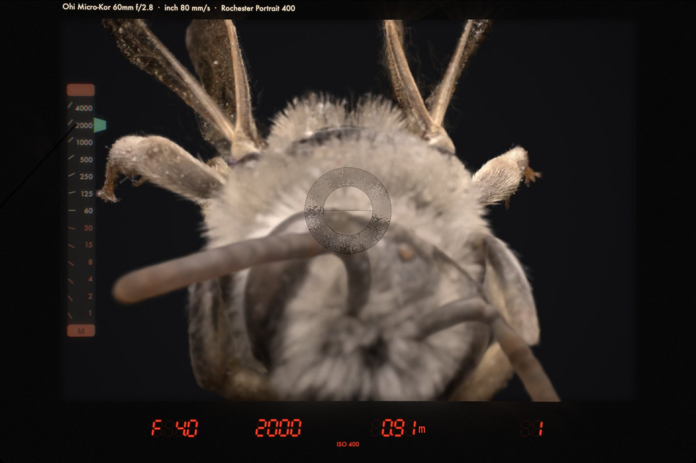
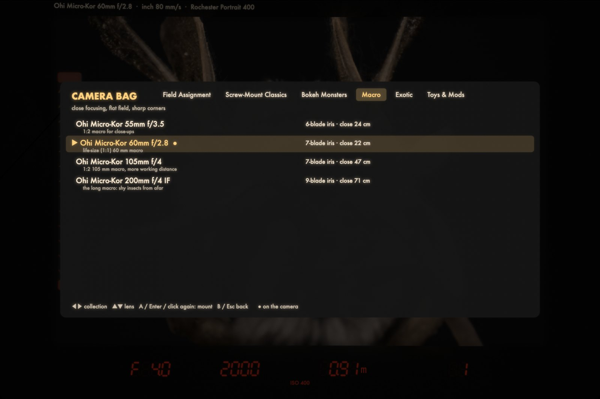
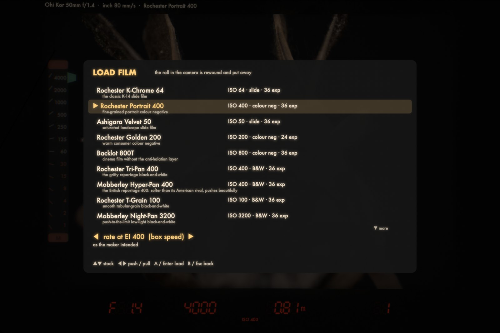
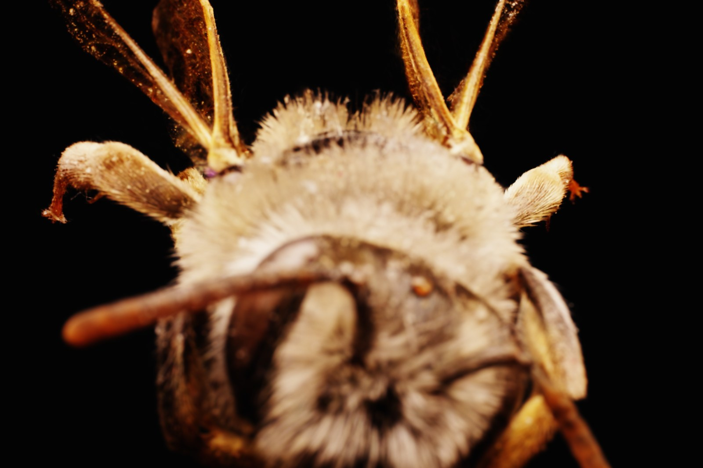
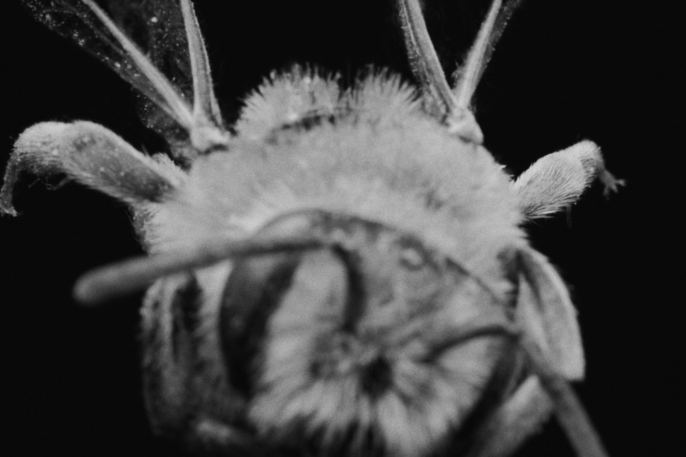
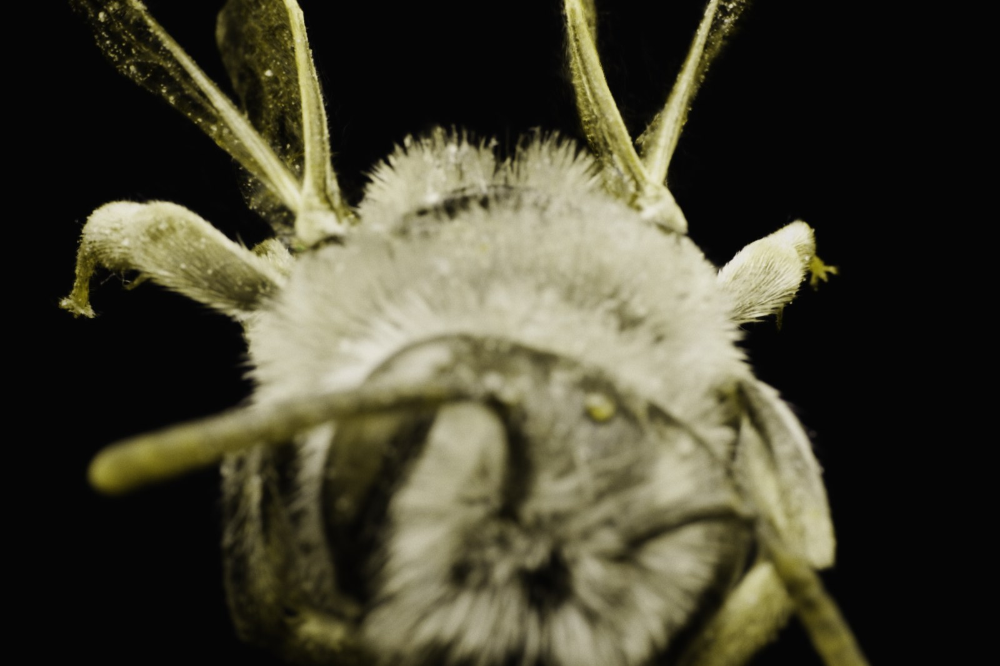
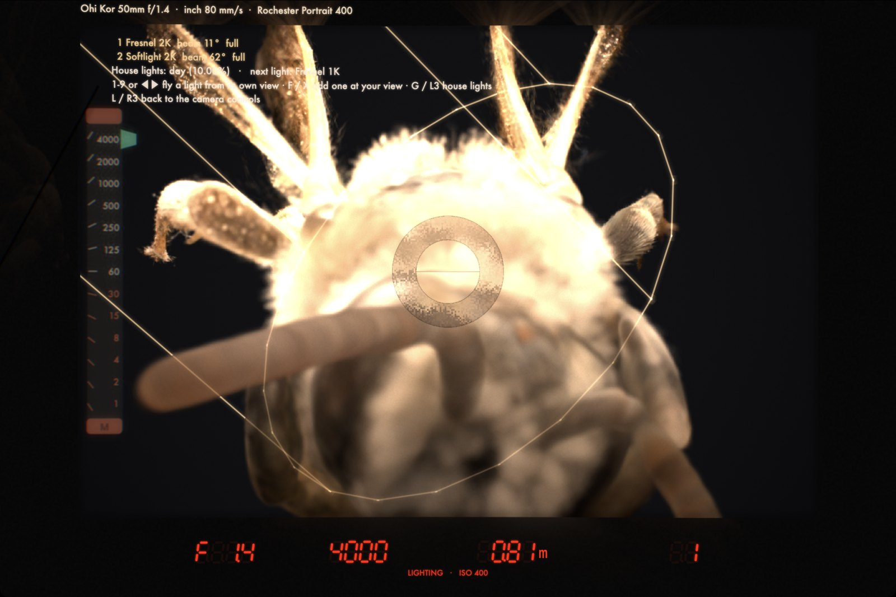
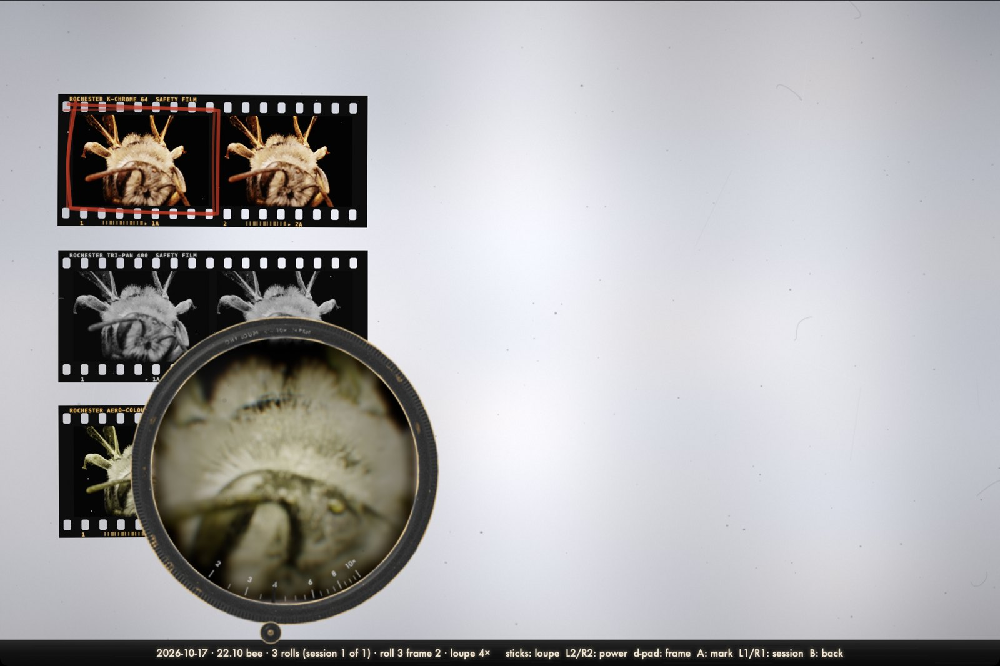
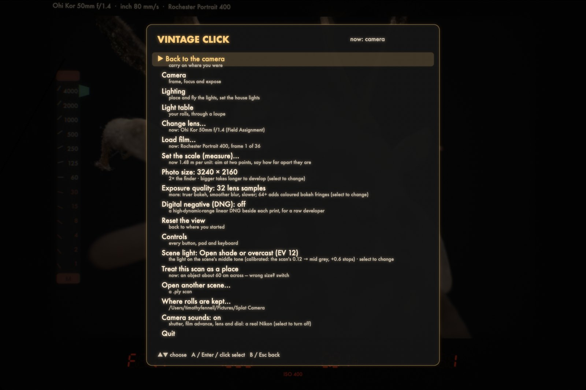
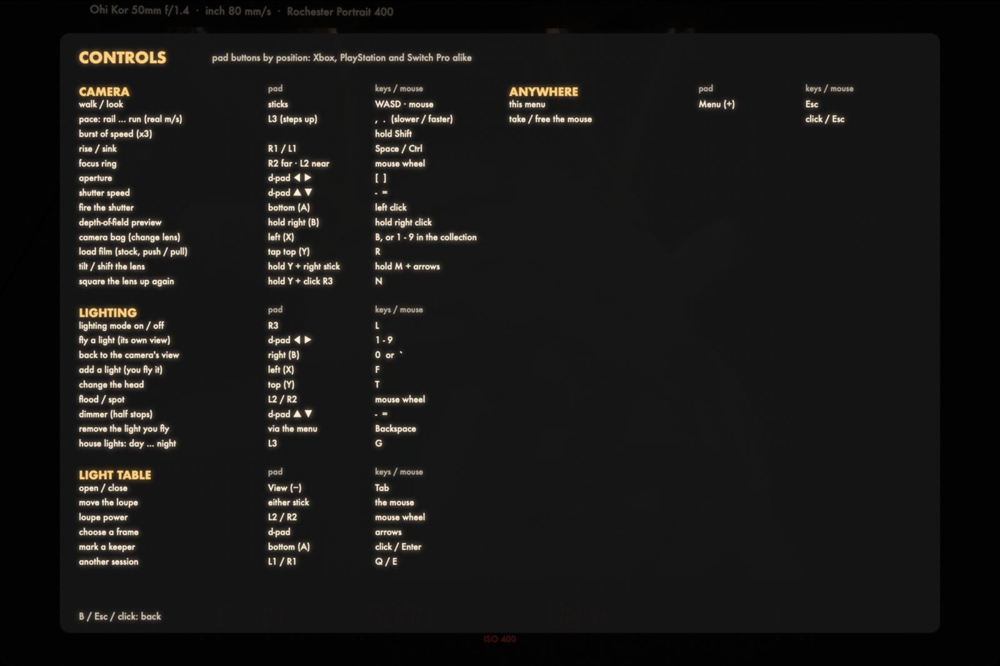

# Vintage Click

A photography game for the Mac (and, in preview, Windows): a manual-focus 35 mm SLR from the 1970s, and
any 3D Gaussian splat scan to walk around in. Focus on a split-prism screen,
read a needle meter, choose a lens from a camera bag and a film stock, light
the scene with tungsten Fresnels, and shoot a roll you only get to see on a
light table, through a loupe.

Everything the camera does comes from the render, not filters laid over it:
depth of field, bokeh shape, swirl, tilt and shift are made by the lens model
inside the splat renderer, and the film's grain, halation and colour come from
the developed exposure.

Free and open source (GPL-3.0).



## System requirements

- **A Mac with Apple silicon** (M1 or later). Intel Macs are not supported.
- **macOS 15.2 (Sequoia) or later.**
- **Memory:** 16 GB is comfortable for scans up to about 10 million splats;
  8 GB is fine for smaller ones (1 to 3 million).
- **Scans:** 3D Gaussian splat `.ply` files, as exported by most trainers and
  by [SuperSplat](https://superspl.at) (position, rotation, scale, opacity and
  spherical-harmonic colour; SH degree 1 to 3).
- **Optional:** a game controller (Xbox, PlayStation or Switch Pro). Keyboard
  and mouse work for everything.

## Install

1. Download `Vintage-Click-macOS.zip` from the
   [latest release](https://github.com/timfennell/vintage-click/releases/latest)
   and unzip it.
2. Move **Vintage Click.app** to your Applications folder.
3. The app is not notarised by Apple, so the first time, **right-click it and
   choose Open**, then Open again in the dialog. (Or, in Terminal:
   `xattr -dr com.apple.quarantine "/Applications/Vintage Click.app"`.)
4. Open it and choose a `.ply` scan. It asks whether the scan is an object
   (made on a turntable or rig) or a place to stand in, and how bright its light
   was; both are remembered per scan and can be changed from the menu.

### Windows (preview)

A Windows version is on its way. The preview has the camera, the viewfinder
and meter, the lens bag, film and the light table; lighting, filters,
tilt/shift and DNG are Mac-only for now.

1. Download `VintageClick-windows-x64.zip` from the
   [latest release](https://github.com/timfennell/vintage-click/releases/latest)
   (or the newest successful
   [Cross-platform build](https://github.com/timfennell/vintage-click/actions/workflows/cross.yml))
   and unzip the whole folder.
2. Double-click **VintageClick.exe**. The program is not signed, so Windows
   SmartScreen says "Windows protected your PC": click **More info**, then
   **Run anyway** (only the first time).
3. Choose a `.ply` scan, or drag one onto the window.

Needs Windows 10 or 11 (64-bit) and a graphics card with a **Vulkan 1.3
driver** (NVIDIA GTX 900 series or newer, AMD RX 400 or newer, Intel Iris Xe or
Arc); if it cannot start the renderer, update the graphics driver. Rolls go to
`Pictures\Vintage Click`. The controls are as below, with Esc for the menu;
`READ ME.txt` in the zip lists them.

Developed rolls are kept in `~/Pictures/Vintage Click` (menu > Where rolls are
kept to change it), filed by day, session and roll.

## A walk through

### The viewfinder

You look through a ground-glass focusing screen, as on a real SLR: the image
is shown at the lens's widest aperture (hold the depth-of-field preview to stop
down and see it darken), with a **split prism** in the middle that breaks a
line in two until it is in focus and a **microprism collar** that shimmers
until it snaps clear. The finder shows the lens's own light fall-off and
colour fringes, the screen's fine matte and fresnel rings, and a slightly
imperfect eyepiece.

Exposure is set the way it was: the **shutter-speed scale** on the left is
projected into the finder, a **meter needle** swings in from the side to the
speed the light wants, and a green tab marks the speed you have set: match
them. Red **seven-segment LEDs** below show aperture, shutter speed, focus
distance and the frame counter.

The meter is honest. Every scan is **calibrated against mid grey** when it
loads (its average tone is brought to 18%), and **Scene light** in the menu says
what light it was made in, from room light (EV 9) to bright sun (EV 15).
Aperture, shutter speed and film speed then behave as on a real camera, film
loses sensitivity on long exposures (reciprocity failure) as real film does,
and the meter does not know about that, as real meters did not.

### Lenses



The camera bag holds about forty lenses on six shelves, each modelled on a real
lens (with fictional maker names that hint at the originals):

- **Field Assignment:** the magazine photographer's primes, 20 mm to 300 mm.
- **Screw-Mount Classics:** multi-coated M42 primes of the early 70s.
- **Bokeh Monsters:** fast glass, from a f/0.95 "dream lens" to a defocus-control 135.
- **Macro:** close-focusing, flat-field lenses down to life size.
- **Exotic:** the f/0.7 satellite lens a director used to film by candlelight,
  a 13 mm rectilinear ultra-wide, full-frame and circular fisheyes, a Petzval,
  a mirror lens with ring bokeh, a soft-focus portrait lens.
- **Toys & Mods:** a Lomo-style compact lens, a plastic toy lens, a Helios-type
  58 mm with its front element reversed (a whirlpool of swirl) or with an
  oval insert and a fishing line across the stop (oval bokeh and horizontal
  streak flares), a bendy tilt lens, and two perspective-control shift lenses.

Each lens has its own aperture blades, cat's-eye vignetting toward the corners,
bubble or smooth bokeh, spherical aberration, field curvature, and lateral and
axial colour, all made by the renderer: a photo is the sum of many renders
through different parts of the lens's aperture.

Focusing close behaves as it does on a real lens: the lens moves out from
the film, so it passes less light (the bellows factor, (1 + magnification)²:
a third of a stop for a 50 mm at its closest, two stops for a macro at 1:1)
and the view narrows (focus breathing; an internal-focus lens widens a little
instead). The finder dims and the through-the-lens meter allows for it.

**Tilt and shift:** with a tilt or shift lens mounted, hold **Y + right stick**
(or **M + arrows**) to move it; **Y + click the right stick** (or **N**) squares
it up again.

### Filters

The camera bag's **Filters** shelf (or **V**) holds what screws onto the front
of the lens, from made-up makers that recall the real ones: neutral density
(1 to 6 stops, to shoot fast film wide open in daylight), contrast filters for
black and white (yellow, orange, red, deep red, green, blue), colour correction
(skylight, warming 81A, 85B amber, 80A blue), cross-screen stars with 4, 6 or
8 points, diffraction gratings that throw rainbow spikes, soft-focus, mist,
black mist and fog. You see the filter in the viewfinder, the meter reads
through it as a through-the-lens meter does, and the film records it.
Fisheyes, the 13 mm and the mirror lens have no front thread: they take colour
and ND filters at the back, and no effect filters.

### Film



Seventeen stocks: slide films, colour and black-and-white negatives, cine
film, a fast night stock, black-and-white infrared, and a false-colour
infrared film that turns foliage crimson. Rate a roll at box speed, pull it a
stop or push it up to three; the whole roll is developed to match, with
contrast, grain and fog to suit. Each stock has its own curve, colour, grain
and halation.

<p>



</p>

*The same bee on slide film, black-and-white and false-colour infrared, through a 60 mm and a 105 mm macro.*

### Lighting



Press **L** (or R3) for lighting mode. Add 1970s tungsten heads (Fresnel 650,
1K and 2K, a 2K softlight, and an ellipsoidal spot), fly each one from its own point of view to aim
it, flood or spot it, dim it, and turn the scan's own light down to night.
Lights relight the scan and cast shadows; their beams come from traced optics
of real Fresnel lenses, not a formula. In the finder the heads appear as
projected wireframes. Each light can carry a **gel** (**C**, or the menu): full,
half and quarter CT blue and CT orange to convert between tungsten and
daylight, and colours from pale straw and bastard amber to primary red,
magenta, moss green, peacock and deep night blue, each with its own light loss.

**Modifiers** (**M** in lighting mode, or the menu): barn doors (trimmed, a
slash, a slit) and flags on stands for the Fresnels and softlight, and
cookies (leaves, plywood breakup, bare branches) that break the beam into
dapples, softer the closer they stand to the lamp. The **Ellipsoidal 750**, a
theatre-style hard-edged zoom spot, takes metal **gobos** in its gate: a
window, venetian blinds, a church window, bars, a leaf breakup. **K** steps a
gobo's focus from sharp to soft, or a cookie's distance from the lamp.

### The light table



Pictures are never shown when you shoot. They are developed in the background
while you keep shooting, and you see them on the light table (**Tab**, or View
on a pad): the whole session's rolls, each cut into strips of six with real
edge printing, under an old brass loupe with its own optics. Slide the loupe
around, turn its knob to zoom from 2x to 10x, and mark keepers with a red
grease pencil.

Every frame is saved as a PNG with a JSON of how it was taken, and optionally as
a high-dynamic-range linear **DNG** (menu > Digital negative) for a raw developer.

### Sound

The camera sounds are a real Nikon, recorded for the game: the shutter at every
speed from 1/2000 to 1 s, the film-advance lever (thirteen takes), the aperture
ring, the shutter-speed dial, changing lenses and loading film. Menu > Camera
sounds turns them on or off.

### The menu



**Esc** (or the pad's Menu button) opens the menu: switch between camera,
lighting and the light table, change lens or film, set the scale by measuring
something you know the size of, choose the photo size and exposure quality,
set the scene's light, switch the scan between object and place, open another
scan, and see every control.

## Controls



| | Pad | Keyboard and mouse |
|---|---|---|
| **Camera** | | |
| walk / look | sticks | WASD, mouse |
| walking pace (rail ... run) | L3 | `,` `.` |
| burst of speed | | hold Shift |
| rise / sink | R1 / L1 | Space / Ctrl |
| focus ring | R2 far, L2 near | mouse wheel |
| aperture | d-pad left / right | `[` `]` |
| shutter speed | d-pad up / down | `-` `=` |
| fire the shutter | A | left click |
| depth-of-field preview | hold B | hold right click |
| camera bag | X | B, or 1-9 within the shelf |
| lens filter (bag's Filters shelf) | menu | V |
| load film | tap Y | R |
| tilt / shift the lens | hold Y + right stick | hold M + arrows |
| square the lens up | hold Y + click R3 | N |
| **Lighting** | | |
| lighting mode on / off | R3 | L |
| fly a light | d-pad left / right | 1-9 |
| back to the camera's view | B | 0 or `` ` `` |
| add a light | X | F |
| change the head | Y | T |
| gel on the light | menu | C |
| modifier: doors, flag, cookie, gobo | menu | M |
| gobo focus / cookie distance | | K |
| flood / spot | L2 / R2 | mouse wheel |
| dimmer (half stops) | d-pad up / down | `-` `=` |
| remove the light you fly | menu | Backspace |
| house lights, day to night | L3 | G |
| **Light table** | | |
| open / close | View | Tab |
| move the loupe | either stick | mouse |
| loupe power | L2 / R2 | mouse wheel |
| choose a frame | d-pad | arrows |
| mark a keeper | A | click / Enter |
| another session | L1 / R1 | Q / E |
| **Anywhere** | | |
| menu | Menu | Esc |
| take / free the mouse | | click / Esc |

## Getting scans

Any 3D Gaussian splat `.ply` works: your own (from a trainer such as Brush,
Postshot, gsplat or Spirula Studio) or one downloaded from
[SuperSplat](https://superspl.at). Scans on SuperSplat belong to their
authors: check each one's license, and credit the author when you share
pictures made from it.

## Building from source

Needs the Xcode Command Line Tools (Xcode itself is not required), Git, and
CMake and Ninja (`brew install cmake ninja`).

1. **The renderer.** Vintage Click draws with
   [Spirula Studio](https://github.com/harry7557558/spirula-studio)'s rasterizer
   (Vulkan, run on Metal through MoltenVK, which the build downloads). This
   repository carries the changes it needs as a patch
   (`renderer/spirula-vintage-click.patch`: the C interface, the thin-lens
   model, frames shared with Metal) against the upstream commit in
   `renderer/UPSTREAM_BASE.txt`. Build it with:

   ```bash
   tools/build_renderer.sh ../spirula
   ```

   It clones Spirula Studio, applies the patch and builds
   `libspirula_render.dylib` (the first build takes a while).

2. **The app:**

   ```bash
   SPIRULA_BUILD=../spirula/build ./build.sh
   ```

   This makes `build/Vintage Click.app`, with the renderer, the sounds and the
   icon inside it.

For testing, the app takes command-line options, e.g.
`open "build/Vintage Click.app" --args scene.ply --lens 22 --film 5 --shoot out.png`
(take one frame and quit), `--bench 200` (render timings), `--stats` (render
speed in the finder).

## Credits

- Rendering: [Spirula Studio](https://github.com/harry7557558/spirula-studio)
  by harry7557558 (GPL-3.0), with
  [MoltenVK](https://github.com/KhronosGroup/MoltenVK) (Apache-2.0).
- Camera sounds recorded by Tim Fennell from his Nikon.
- Lens and film names are fictional; the lenses and stocks they recall belong
  to their makers.
- The bee in the screenshots is a scan by Tim Fennell.

## License

GPL-3.0. See [LICENSE](LICENSE).
